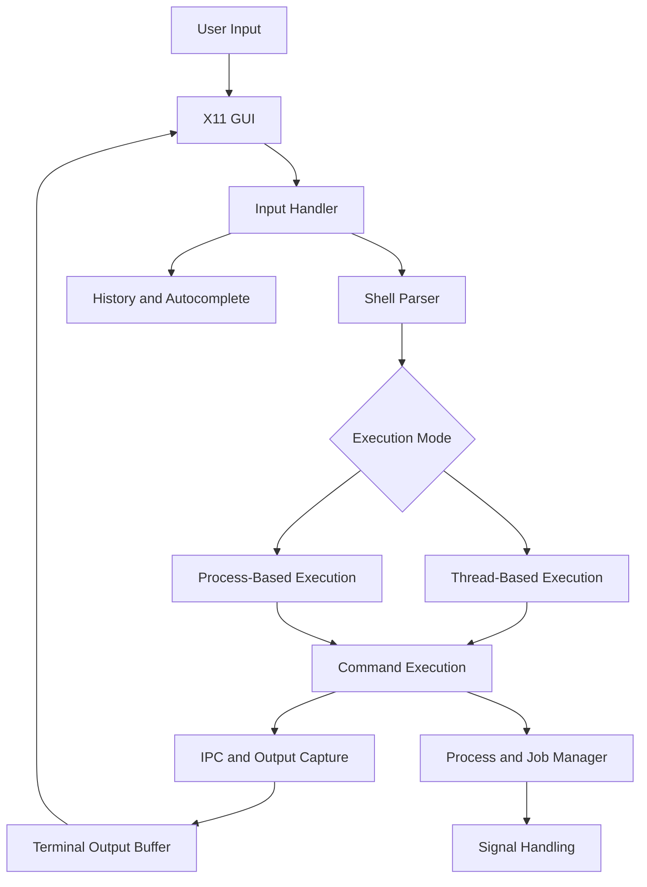

# Terminator — Software Design Document

**Project:** Terminator — Custom Terminal Emulator  
**Language:** C  
**GUI Framework:** Xlib / X11  
**Platform:** Unix-like operating systems

---

## 1. Introduction

Terminator is a graphical terminal emulator and custom shell developed in C. The application provides an X11-based interface through which users can enter commands, view their output, manage multiple terminal tabs, and interact with running processes.

The project combines graphical event handling with Unix process management and inter-process communication.

The primary design objectives are:

- Provide a responsive graphical terminal interface.
- Support independent terminal sessions through multiple tabs.
- Execute external commands and shell operations.
- Support both thread-based and process-based execution modes.
- Capture and display command output without blocking the GUI.
- Implement process management, job control, and signal handling.
- Provide command history and autocomplete functionality.

## 2. System Architecture

Terminator follows a modular architecture in which the graphical interface, input handling, shell execution, process management, and supporting utilities are separated into different modules.

### 2.1 High-Level Architecture



### 2.2 Main Modules

| Module | Responsibility |
|---|---|
| `main.c` | Application initialization and main event loop |
| `gui.c` | X11 window management, rendering, and tabs |
| `input.c` | Keyboard input, editing, and command submission |
| `shell.c` | Command parsing, execution, pipelines, and job management |
| `io_redirect.c` | Input/output redirection |
| `variables.c` | Shell variable storage and expansion |
| `history.c` | Persistent command history |
| `completion.c` | Command and filename autocomplete |
| `scroll.c` | Output scrolling |
| `hotkeys.c` | Keyboard shortcuts and cursor navigation |

---

## 3. X11 GUI and Event Loop

### 3.1 GUI Design

The graphical interface is implemented using Xlib.

The application initializes an X11 connection using `XOpenDisplay()` and creates a window using `XCreateSimpleWindow()`.

The GUI maintains the following important state:

- X11 display connection.
- Main terminal window.
- Graphics context.
- Terminal output buffer.
- Input buffer and cursor position.
- Terminal tab array.
- Active tab index.
- Scroll position.

The GUI is responsible for rendering the terminal prompt, user input, command output, and tab interface.

### 3.2 Event-Driven Architecture

The application uses an event-driven architecture instead of continuously polling for keyboard input in a busy loop.

The main loop monitors:

1. The X11 connection.
2. Output file descriptors belonging to running processes.
3. Output descriptors associated with background jobs and monitoring commands.

The `poll()` system call allows the application to wait for activity on these descriptors.

A simplified representation is:

```c
while (running)
{
    int result = poll(fds, count, timeout);

    if (result < 0)
    {
        if (errno == EINTR)
            continue;
    }

    if (fds[0].revents & POLLIN)
    {
        while (XPending(display))
        {
            XEvent event;
            XNextEvent(display, &event);

            if (event.type == Expose)
                gui_draw();

            else if (event.type == KeyPress)
                handle_keypress(&event.xkey);
        }
    }

    read_tab_output();
}
```

This is a simplified illustration of the event loop; the actual implementation also monitors job and monitoring-command output.

### 3.3 Event Handling

| Event | Action |
|---|---|
| `Expose` | Redraw the terminal window |
| `KeyPress` | Process keyboard input |
| `ButtonPress` | Handle tab and mouse interactions |
| Pipe readability | Read command output |
| Pipe closure | Detect process output completion |

### 3.4 Why `poll()` Is Used

Using `poll()` allows the GUI and command execution system to cooperate without blocking each other.

For example, while a command is running, the application can still:

- Process keyboard events.
- Redraw the window.
- Update output buffers.
- Handle output from other tabs.
- Detect process termination.

This design improves responsiveness and avoids unnecessary CPU usage.

---

## 4. Thread Mode vs Process Mode

Terminator supports two execution modes:

```bash
./terminator
```

and

```bash
./terminator useProcess=True
```

These modes provide different execution approaches for command processing.

### 4.1 Thread-Based Execution

In thread mode, command execution is organized around threads within the application.

Threads share the application's address space, which allows them to access shared terminal state directly.

Advantages:

- Lower overhead for creating execution contexts.
- Shared memory access without explicit IPC for internal state.
- Convenient access to application-level data.

Challenges:

- Shared state requires synchronization.
- Concurrent updates to buffers or tab state can cause race conditions.
- Thread termination and cleanup must be managed carefully.

### 4.2 Process-Based Execution

In process mode, command execution is organized around separate processes.

The application creates child processes using Unix process-management facilities such as `fork()` and executes external commands using `exec()` functions.

Advantages:

- Process isolation.
- Independent execution environments.
- Better separation between the GUI and command execution.
- Natural integration with Unix pipes and file descriptors.

Challenges:

- Requires explicit IPC for communicating command output.
- Process creation and cleanup introduce additional overhead.
- Child processes must be monitored and reaped.

### 4.3 Comparison

| Property | Thread Mode | Process Mode |
|---|---|---|
| Execution unit | Thread | Process |
| Address space | Shared | Separate |
| State access | Direct shared-memory access | IPC or explicit communication |
| Isolation | Lower | Higher |
| Synchronization | Mutexes or other synchronization primitives when state is shared | Process coordination and IPC |
| Output capture | Shared buffers or communication channels | Pipes and file descriptors |
| Cleanup | Thread termination and joining | Process termination and `waitpid()` |
| Typical advantage | Lower execution overhead | Better isolation |

### 4.4 Shared State Synchronization

Thread mode requires careful coordination when multiple execution contexts access shared application data.

Important shared state includes:

- Terminal output buffers.
- Tab metadata.
- Process status.
- Command history.
- Input state.
- Job information.

A synchronization mechanism such as a mutex can protect critical sections.

Conceptually:

```c
lock(shared_state_mutex);

/* Update shared terminal state */

unlock(shared_state_mutex);
```

The design principle is to keep critical sections short and avoid holding synchronization locks while performing blocking operations.

In process mode, separate address spaces prevent ordinary global variables from being automatically shared. Communication therefore uses pipes, file descriptors, or other explicit IPC mechanisms.

**Implementation note:** The precise synchronization primitives and their use should be documented according to the final thread-mode source implementation.

---

## 5. Process and Job Management

### 5.1 Process Creation

External commands are executed in child processes.

The general execution sequence is:

1. Parse the command.
2. Create the required communication pipes.
3. Create a child process using `fork()`.
4. Configure the child's file descriptors.
5. Execute the requested program.
6. Monitor the child process.
7. Collect its output and exit status.
8. Release resources.

### 5.2 Process Groups

Related processes can be organized into process groups.

Process groups are useful for managing pipelines and delivering signals to an entire job.

For example:

```bash
cat input.txt | grep hello | wc -l
```

The processes involved in the pipeline can be managed as a single job.

Terminator uses process-group operations to support job control and signal delivery.

### 5.3 Job Data Structures

The shell maintains job-related state, including:

- Process group ID.
- Child process IDs.
- Output file descriptor.
- Job status.
- Whether the job is active.
- Associated terminal tab.

A simplified representation is:

```c
typedef struct
{
    pid_t pgid;
    pid_t child_pids[MAX_PIPE_COMMANDS];

    int child_count;
    int output_fd;

    int used;
    int running;
} ShellJob;
```

This illustrates the conceptual structure; the actual project structure contains additional fields.

### 5.4 Foreground and Background Jobs

Foreground jobs are associated with the currently active command execution.

Background jobs can continue running while the user interacts with the terminal.

The shell monitors their output and process status independently of the GUI's input handling.

### 5.5 Process Completion

The shell uses process-status monitoring to determine when commands finish.

When a child process terminates:

- Its exit status is collected.
- Its output descriptor is closed when appropriate.
- Its job state is updated.
- The associated terminal tab is notified.
- Resources are released.

---

## 6. Inter-Process Communication

IPC is a central part of Terminator because the GUI must receive output from independently executing commands.

### 6.1 Pipes

A pipe provides a unidirectional communication channel between processes.

It is created using:

```c
int fd[2];

pipe(fd);
```

The two descriptors represent:

- `fd[0]` — read end.
- `fd[1]` — write end.

A child process writes command output into the pipe, while the parent process reads the output and displays it in the terminal.

### 6.2 Standard Output Capture

A typical execution sequence is:

```c
int fd[2];

pipe(fd);

pid_t pid = fork();

if (pid == 0)
{
    close(fd[0]);

    dup2(fd[1], STDOUT_FILENO);
    dup2(fd[1], STDERR_FILENO);

    close(fd[1]);

    execvp(args[0], args);

    perror("execvp");
    exit(EXIT_FAILURE);
}
else
{
    close(fd[1]);

    /* Parent reads command output */
}
```

This is a simplified example of the output-capture mechanism.

### 6.3 The Role of `dup2()`

The `dup2()` system call redirects a file descriptor to another descriptor.

For example:

```c
dup2(fd[1], STDOUT_FILENO);
```

This redirects standard output to the pipe's write end.

Similarly:

```c
dup2(fd[1], STDERR_FILENO);
```

redirects standard error.

As a result, output generated by the executed command can be captured by the parent process.

### 6.4 Input and Output Redirection

Terminator supports:

```bash
./myprog < infile.txt
```

```bash
echo hello > outfile.txt
```

```bash
./myprog < infile.txt > outfile.txt
```

Input redirection replaces standard input with a file descriptor opened for reading.

Output redirection replaces standard output with a file descriptor opened for writing.

The `io_redirect.c` module is responsible for the corresponding redirection logic.

### 6.5 Pipelines

For a pipeline:

```bash
command1 | command2
```

the shell creates a pipe and connects:

- Standard output of `command1` to the pipe's write end.
- Standard input of `command2` to the pipe's read end.

For multiple commands, the shell creates a chain of pipes.

Unused descriptors must be closed in both parent and child processes to prevent resource leaks and ensure that EOF is detected correctly.

---

## 7. Command History

Terminator provides command history for recalling and searching previously entered commands.

### 7.1 In-Memory History

The input module maintains per-tab command history.

The data structure is based on a fixed-size array:

```c
static char history[MAX_TABS][HISTORY_LIMIT][INPUT_SIZE];

static int history_count[MAX_TABS];
static int history_pos[MAX_TABS];
```

Each tab has:

- A list of stored commands.
- A count of stored commands.
- A current browsing position.

The history is bounded. When the history reaches its maximum capacity, the oldest command is removed to make room for a new entry.

### 7.2 Persistent History

The history module also stores commands in a persistent file:

```text
~/.terminator_history
```

The file is loaded during initialization and updated as commands are entered.

### 7.3 History Navigation

The user can navigate through previous commands using keyboard shortcuts.

The implementation also supports reverse history search.

The history module uses string comparison and search logic to locate matching commands.

### 7.4 Design Rationale

A fixed-size array provides:

- Predictable memory usage.
- Simple indexing.
- Efficient command retrieval.
- Straightforward removal of old entries.

Persistent storage allows command history to survive application restarts.

---

## 8. Command Autocomplete

Autocomplete is implemented in the `completion.c` module.

### 8.1 Data Structures

The completion module maintains a bounded list of matching entries.

A representative structure is:

```c
#define COMPLETION_MAX_MATCHES 100

static char matches[COMPLETION_MAX_MATCHES][NAME_MAX + 1];
```

Each entry stores a candidate completion.

### 8.2 Completion Process

The autocomplete system:

1. Reads the current input buffer.
2. Identifies the word or filename being completed.
3. Determines the relevant directory or command context.
4. Searches for matching candidates.
5. Stores the matches in a bounded array.
6. Presents or selects a completion.
7. Updates the input buffer.

### 8.3 Design Rationale

A fixed-size candidate array simplifies memory management and avoids unbounded allocation during interactive input.

The completion system is separated from the main input handler so that autocomplete logic can be maintained independently.

---

## 9. Signal Handling

Signals provide a mechanism for communicating events to processes.

Terminator uses signals to support process interruption, suspension, and job control.

### 9.1 Important Signals

| Signal | Purpose |
|---|---|
| `SIGINT` | Interrupt a foreground process |
| `SIGTSTP` | Suspend a foreground job |
| `SIGCONT` | Resume a suspended job |
| `SIGTERM` | Request process termination |
| `SIGCHLD` | Notify the parent about child-process state changes |

### 9.2 Ctrl+C

When the user presses `Ctrl+C`, the input handler identifies the foreground process group and sends `SIGINT`.

Conceptually:

```c
kill(-foreground_pgid, SIGINT);
```

The negative process-group ID allows the signal to be delivered to the job's process group rather than only one process.

### 9.3 Ctrl+Z

When the user presses `Ctrl+Z`, the shell sends `SIGTSTP` to the foreground job.

The job can subsequently be resumed using `SIGCONT`.

### 9.4 Signal Safety

Signal handlers should avoid performing complex operations such as GUI rendering, memory allocation, or non-async-signal-safe functions.

A safer design is to keep signal handlers minimal and defer complex processing to the main event loop.

This reduces the risk of corrupted shared state and unexpected behavior.

---

## 10. Multi-Tab Architecture

Terminator supports multiple terminal tabs.

Each tab maintains independent terminal state, including:

- Input buffer.
- Output buffer.
- Current working directory.
- Process information.
- Scroll position.
- Job information.
- Execution status.

The tab array is maintained by the GUI and shell modules.

When the user switches tabs, the active tab's state is loaded into the visible terminal interface.

### Design Rationale

Keeping terminal state associated with each tab provides isolation between terminal sessions.

For example, changing the working directory in one tab does not change the working directory of another tab.

This design also allows output from inactive tabs to be collected and displayed when the user switches back to them.

---

## 11. Additional Design Decisions

### 11.1 Modular Source Files

The project is divided into separate modules to improve maintainability.

Each module has a well-defined responsibility, reducing coupling between the GUI, input handling, and shell execution.

### 11.2 Non-Blocking GUI

The GUI must remain responsive while external commands are executing.

Using `poll()` allows the main loop to monitor both GUI events and process output.

### 11.3 Bounded Buffers

Fixed-size buffers are used for several terminal data structures.

Advantages include:

- Predictable memory consumption.
- Simple memory management.
- Reduced dynamic allocation.
- Easier bounds checking.

The implementation must ensure that operations do not exceed buffer capacities.

### 11.4 Separation of Shell and GUI

The shell is responsible for command execution and process management.

The GUI is responsible for displaying output and handling user interaction.

This separation makes it possible to modify the interface without rewriting the command execution system.

### 11.5 Error Handling

System calls such as `fork()`, `pipe()`, `dup2()`, `poll()`, and `execvp()` may fail.

The implementation checks for errors and reports relevant failures.

Error handling is especially important for process creation and file descriptor management, where failures can otherwise leave the application in an inconsistent state.

---

## 12. Limitations and Future Improvements

Potential areas for further development include:

- More complete shell syntax support.
- Improved terminal rendering and terminal-emulation compatibility.
- More advanced job-control commands.
- Improved handling of concurrent output from multiple tabs.
- More comprehensive synchronization in thread mode.
- Additional shell scripting capabilities.
- Improved command completion and history search.
- More robust cleanup during application shutdown.

---

## 13. Conclusion

Terminator combines graphical programming with operating system concepts to create a custom terminal emulator.

Its design demonstrates:

- Event-driven programming using X11.
- Process and thread execution models.
- Process groups and job management.
- Inter-process communication using pipes.
- File descriptor manipulation using `dup2()`.
- Input/output redirection.
- Signal handling.
- Command history and autocomplete.
- Modular systems programming in C.

The separation of the GUI, shell, process management, and supporting modules provides a foundation for extending the terminal with additional functionality.

